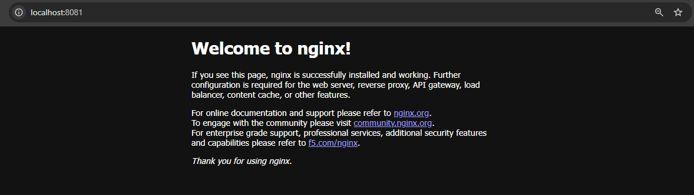

# Terraform Docker Infrastructure

## Project Overview

This project demonstrates the use of **Infrastructure as Code (IaC)** with Terraform to provision and manage a Docker container on a local system.

Terraform is used with the Docker provider to manage an NGINX Docker image and provision an NGINX container. The container exposes the NGINX web server through port `8081` on the host machine.

The project demonstrates the complete Terraform infrastructure lifecycle:

```text
Initialize → Plan → Apply → Verify → Inspect State → Destroy
```

Execution logs from each major Terraform operation are included in the repository as evidence of the completed workflow.

---

## Tools and Technologies

- **Terraform** – Infrastructure as Code tool used to define and manage the infrastructure
- **Docker** – Container platform used to run the NGINX container
- **NGINX** – Web server used as the containerized application
- **Git** – Version control
- **GitHub** – Source code repository
- **Visual Studio Code** – Development environment

---

## Project Structure

```text
terraform-docker-container/
│
├── logs/
│   ├── nginx-running.png
│   ├── terraform-apply.txt
│   ├── terraform-destroy.txt
│   ├── terraform-init.txt
│   ├── terraform-plan.txt
│   └── terraform-state.txt
│
├── .gitignore
├── .terraform.lock.hcl
├── main.tf
└── README.md
```

### Important Files

| File | Description |
|---|---|
| `main.tf` | Defines the Terraform provider, Docker image, container, and port mapping |
| `.terraform.lock.hcl` | Records the selected Terraform provider versions and checksums |
| `.gitignore` | Prevents local Terraform working files and state files from being committed |
| `logs/` | Contains execution logs and verification evidence from the Terraform workflow |

---

## Infrastructure Architecture

The infrastructure created by Terraform follows this flow:

```text
Terraform Configuration (main.tf)
            │
            ▼
     Terraform CLI
            │
            ▼
      Docker Provider
            │
            ▼
       Docker Engine
            │
            ├── nginx:latest image
            │
            ▼
   terraform-nginx container
            │
            ▼
Host Port 8081 → Container Port 80
```

NGINX listens on port `80` inside the Docker container.

The container port is mapped to:

```text
localhost:8081
```

on the host machine.

Port `8081` was selected because port `8080` was already being used by Jenkins on the local system.

---

## Terraform Configuration

The infrastructure is defined in `main.tf`.

### Docker Provider

The project uses the Docker provider:

```hcl
terraform {
  required_providers {
    docker = {
      source  = "kreuzwerker/docker"
      version = "~> 3.0"
    }
  }
}

provider "docker" {}
```

Terraform providers allow Terraform to communicate with external platforms and APIs. In this project, the Docker provider allows Terraform to communicate with the local Docker Engine.

---

### Docker Image Resource

The NGINX image is managed using:

```hcl
resource "docker_image" "nginx" {
  name         = "nginx:latest"
  keep_locally = false
}
```

This ensures that the required `nginx:latest` image is available for the container.

---

### Docker Container Resource

The NGINX container is defined using:

```hcl
resource "docker_container" "nginx" {
  name  = "terraform-nginx"
  image = docker_image.nginx.image_id

  ports {
    internal = 80
    external = 8081
  }
}
```

The reference:

```hcl
docker_image.nginx.image_id
```

creates an implicit dependency between the Docker image and Docker container.

Terraform therefore understands that the image must be available before the container can be created.

---

# Terraform Workflow

## 1. Initialize Terraform

The Terraform working directory was initialized using:

```bash
terraform init
```

This command:

- Initialized the Terraform project
- Installed the required Docker provider
- Created the local `.terraform` working directory
- Generated the `.terraform.lock.hcl` dependency lock file

The initialization completed successfully.

Execution log:

```text
logs/terraform-init.txt
```

---

## 2. Review the Infrastructure Plan

Before creating any infrastructure, the proposed changes were reviewed using:

```bash
terraform plan
```

Terraform detected that two resources needed to be created:

```text
Plan: 2 to add, 0 to change, 0 to destroy.
```

The planned resources were:

```text
docker_image.nginx
docker_container.nginx
```

Using `terraform plan` allowed the infrastructure changes to be reviewed before they were applied.

Execution log:

```text
logs/terraform-plan.txt
```

---

## 3. Provision the Infrastructure

The infrastructure was provisioned using:

```bash
terraform apply
```

After reviewing the execution plan, the operation was confirmed.

Terraform successfully created both resources:

```text
Apply complete! Resources: 2 added, 0 changed, 0 destroyed.
```

Terraform created:

- The `nginx:latest` Docker image resource
- The `terraform-nginx` Docker container

Execution log:

```text
logs/terraform-apply.txt
```

---

## 4. Verify the Docker Container

After Terraform completed the provisioning process, the running container was verified using:

```bash
docker ps
```

The `terraform-nginx` container was running successfully with the port mapping:

```text
Host Port 8081 → Container Port 80
```

The NGINX web server was then accessed through:

```text
http://localhost:8081
```

The default NGINX welcome page confirmed that the Terraform-provisioned container was running and accessible.

### Verification Screenshot



---

## 5. Inspect Terraform State

Terraform state was inspected using:

```bash
terraform state list
```

Terraform reported the following managed resources:

```text
docker_container.nginx
docker_image.nginx
```

Detailed information about the container was inspected using:

```bash
terraform state show docker_container.nginx
```

The state information included details such as:

- Docker container ID
- Docker image ID
- Container name
- Network configuration
- Port mapping
- Runtime configuration

Execution log:

```text
logs/terraform-state.txt
```

### Terraform State Concept

Terraform state acts as the mapping between the Terraform configuration and the infrastructure Terraform manages.

```text
main.tf
Desired Infrastructure
        │
        ▼
Terraform State
Tracked Infrastructure
        │
        ▼
Docker Resources
Actual Infrastructure
```

This allows Terraform to determine whether infrastructure needs to be created, modified, or destroyed.

---

## 6. Verify Infrastructure Consistency

After the infrastructure was created, `terraform plan` was executed again without changing the configuration.

Terraform refreshed the existing resources and reported:

```text
No changes. Your infrastructure matches the configuration.
```

This demonstrated that Terraform recognized the existing infrastructure instead of attempting to create duplicate resources.

---

## 7. Destroy the Infrastructure

After verification and state inspection, the infrastructure was removed using:

```bash
terraform destroy
```

Terraform identified both managed resources for destruction:

```text
Plan: 0 to add, 0 to change, 2 to destroy.
```

After confirmation, Terraform successfully removed the resources:

```text
Destroy complete! Resources: 2 destroyed.
```

This completed the full Terraform infrastructure lifecycle.

Execution log:

```text
logs/terraform-destroy.txt
```

---

## Execution Logs

The repository contains execution logs from the Terraform workflow:

| Log | Purpose |
|---|---|
| `terraform-init.txt` | Terraform initialization and provider setup |
| `terraform-plan.txt` | Infrastructure creation plan |
| `terraform-apply.txt` | Infrastructure provisioning output |
| `terraform-state.txt` | Terraform-managed resource state |
| `terraform-destroy.txt` | Infrastructure destruction output |
| `nginx-running.png` | Browser verification of the running NGINX container |

These logs provide evidence of the complete Terraform workflow performed during the project.

---

## Terraform Files and Git

Terraform generates several local files during execution.

The following are excluded from Git using `.gitignore`:

```text
.terraform/
*.tfstate
*.tfstate.*
crash.log
crash.*.log
```

The `.terraform` directory contains locally downloaded provider files and can be recreated using `terraform init`.

Terraform state files are also excluded because state can contain environment-specific or sensitive infrastructure information.

The following file **is committed**:

```text
.terraform.lock.hcl
```

The lock file records the provider versions and checksums selected by Terraform, helping maintain consistent provider dependencies.

---

## Key Concepts Demonstrated

### Infrastructure as Code

Infrastructure as Code allows infrastructure to be defined using configuration files instead of manually creating resources.

In this project, the required Docker infrastructure is described entirely in `main.tf`.

### Terraform Providers

Providers allow Terraform to interact with external platforms.

The Docker provider was used to communicate with the local Docker Engine.

### Terraform Resources

Resources represent infrastructure objects managed by Terraform.

This project uses:

```text
docker_image.nginx
docker_container.nginx
```

### Resource Dependency

The container references:

```hcl
docker_image.nginx.image_id
```

This creates an implicit dependency between the image and the container.

### Terraform Plan vs Apply

`terraform plan` previews the changes Terraform intends to make without creating infrastructure.

`terraform apply` executes the proposed changes and brings the actual infrastructure in line with the Terraform configuration.

### Terraform State

Terraform state records information about resources Terraform manages and allows Terraform to compare the desired configuration with the existing infrastructure.

---

## What I Learned

Through this project, I gained practical experience with:

- Understanding the fundamentals of Infrastructure as Code
- Installing and configuring Terraform
- Working with Terraform providers
- Defining infrastructure using Terraform resources
- Provisioning Docker resources through Terraform
- Understanding resource dependencies
- Using `terraform init`, `plan`, `apply`, and `destroy`
- Inspecting Terraform state
- Understanding the difference between desired configuration and actual infrastructure
- Verifying Terraform-provisioned resources through Docker
- Managing Terraform-generated files appropriately with Git
- Capturing execution logs for infrastructure operations

---

## Conclusion

This project demonstrates a complete Infrastructure as Code workflow using **Terraform and Docker**.

Terraform was used to define and provision an NGINX Docker container, inspect the managed infrastructure through Terraform state, verify the running service, and finally destroy the provisioned resources.

The project demonstrates how infrastructure can be managed in a **repeatable, declarative, and version-controlled** manner using Terraform.